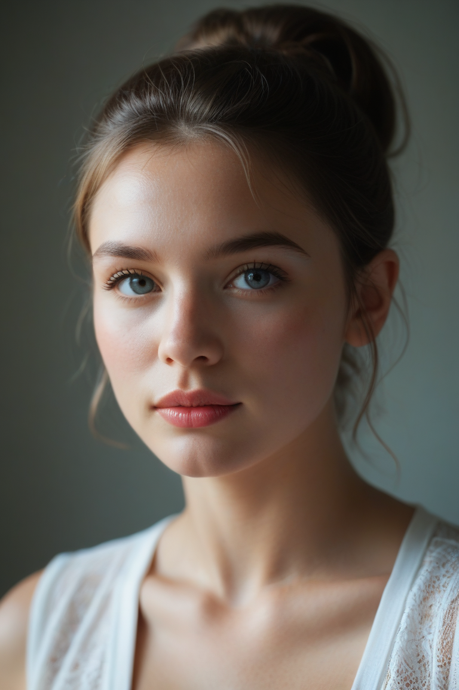
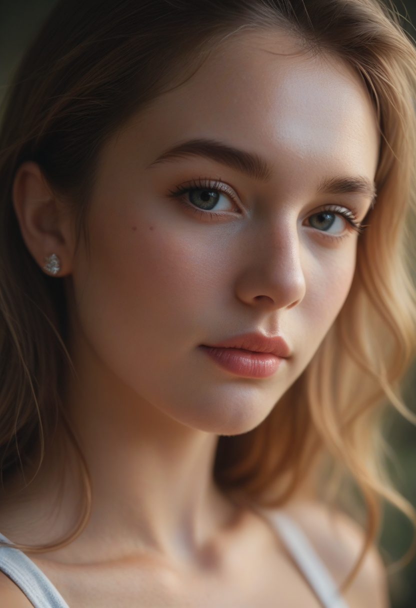
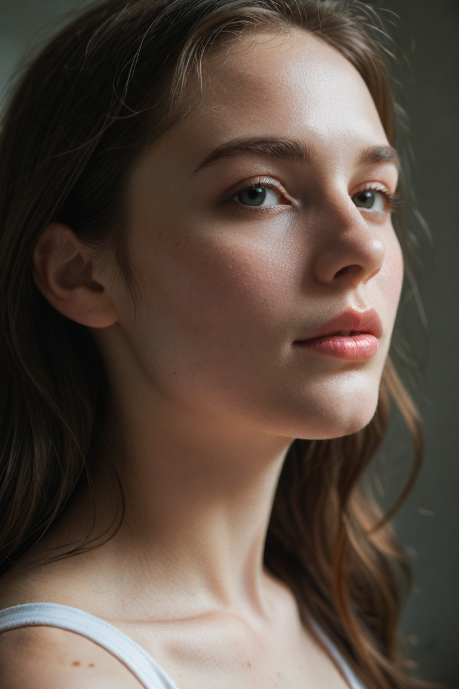

# ChatrXL Uncensored

[](https://huggingface.co/chatrlabs/ChatrXL-Uncensored)
[](https://chatrlabs.com/playground)

**Chatr Labs' uncensored SDXL/Pony-family checkpoint — a 20-step quality build and an 8-step DMD2 fast build.**

This repository holds the documentation, inference example and checksums. Weights live on Hugging Face.

## Download

| Build | File | Steps | CFG | Sampler | Size |
| --- | --- | ---: | ---: | --- | ---: |
| **Quality** (v3.3 lineage) | [chatrxl-uncensored-fp16.safetensors](https://huggingface.co/chatrlabs/ChatrXL-Uncensored/resolve/main/chatrxl-uncensored-fp16.safetensors?download=true) | 20 | 5.0 | `euler_a` | 6.94 GB |
| **DMD2 fast** (v3.2 DMD2 lineage) | [chatrxl-uncensored-dmd2-fp16.safetensors](https://huggingface.co/chatrlabs/ChatrXL-Uncensored/resolve/main/chatrxl-uncensored-dmd2-fp16.safetensors?download=true) | 8 | 1.1 | `LCM` | 6.94 GB |

Both are complete single-file checkpoints. The VAE and both text encoders are included; no base model download is required.

File integrity information is in [SHA256SUMS](./SHA256SUMS).

### Required embeddings

Download both files from the Hugging Face repository:

- [BSY_General_Positives_V1_PRO.safetensors](https://huggingface.co/chatrlabs/ChatrXL-Uncensored/resolve/main/embeddings/BSY_General_Positives_V1_PRO.safetensors?download=true)
- [BSY_Anatomy_Negatives_V1_PRO.safetensors](https://huggingface.co/chatrlabs/ChatrXL-Uncensored/resolve/main/embeddings/BSY_Anatomy_Negatives_V1_PRO.safetensors?download=true)

## Recommended settings

### Quality build

| Setting | Value |
| --- | --- |
| Sampling steps | **20** |
| CFG scale | **5.0** |
| Sampler | `euler_a` |
| Resolution | 768 × 1152, 832 × 1216, or 1024 × 1024 |
| Prompt prefix | `score_9, score_8_up, score_7_up,` |
| Positive embedding | `BSY_General_Positives_V1_PRO` |
| Negative prompt | `BSY_Anatomy_Negatives_V1_PRO` |
| IP-Adapter (optional) | Scale 0.1 |

### DMD2 fast build

| Setting | Value |
| --- | --- |
| Sampling steps | **8** |
| CFG scale | **1.1** |
| Sampler | `LCM` |
| Resolution | 768 × 1152, 832 × 1216, or 1024 × 1024 |
| Prompt prefix | `score_9, score_8_up, score_7_up,` |
| Positive embedding | `BSY_General_Positives_V1_PRO` |
| Negative prompt | `BSY_Anatomy_Negatives_V1_PRO` |
| IP-Adapter (optional) | Scale 0.1 |

IP-Adapter is optional; the checkpoint works without it. The DMD2 build is an accelerated v3.2 DMD2 checkpoint, not a distillation of the v3.3 quality build — small composition differences are expected.

## ComfyUI

```
ComfyUI/models/
├── checkpoints/   chatrxl-uncensored-fp16.safetensors
├── embeddings/    BSY_General_Positives_V1_PRO.safetensors
└── embeddings/    BSY_Anatomy_Negatives_V1_PRO.safetensors
```

1. `Load Checkpoint` → the ChatrXL Uncensored checkpoint
2. `CLIP Text Encode` (positive) → `score_9, score_8_up, score_7_up, BSY_General_Positives_V1_PRO, <prompt>`
3. `CLIP Text Encode` (negative) → `BSY_Anatomy_Negatives_V1_PRO`
4. `KSampler` → `euler_ancestral` 20 steps CFG 5.0, or `lcm` 8 steps CFG 1.1
5. `VAE Decode` → `Save Image`

Ready-to-run workflows are included:

- [`comfyui/chatrxl-quality.json`](./comfyui/chatrxl-quality.json) — 20 steps, `euler_ancestral`, CFG 5.0
- [`comfyui/chatrxl-dmd2.json`](./comfyui/chatrxl-dmd2.json) — 8 steps, `lcm`, CFG 1.1
- API-format copies: [`comfyui/chatrxl-quality-api.json`](./comfyui/chatrxl-quality-api.json), [`comfyui/chatrxl-dmd2-api.json`](./comfyui/chatrxl-dmd2-api.json)

Tested with ComfyUI 0.43.0 using only built-in nodes. See [`comfyui/README.md`](./comfyui/README.md).

## Diffusers

Install the dependencies and run the included example:

```bash
pip install -r requirements.txt
python inference.py \
  --prompt "a portrait of a woman in a sunlit apartment, natural skin texture, 35mm photograph" \
  --output chatrxl-uncensored.png
```

For the DMD2 build:

```bash
python inference.py --fast \
  --model chatrxl-uncensored-dmd2-fp16.safetensors \
  --prompt "a portrait of a woman at night, neon reflections" \
  --output chatrxl-uncensored-dmd2.png
```

The script uses `StableDiffusionXLPipeline.from_single_file`, switches to `EulerAncestralDiscreteScheduler` or `LCMScheduler`, and loads the two textual-inversion embeddings from `embeddings/`.

## Prompting

```
score_9, score_8_up, score_7_up, BSY_General_Positives_V1_PRO,
a portrait of a woman in a sunlit apartment, natural skin texture,
35mm photograph, soft window light
```

Negative prompt:

```
BSY_Anatomy_Negatives_V1_PRO
```

The two BSY embeddings are 64-token multi-vector embeddings. ComfyUI expands them across CLIP chunks automatically; the Diffusers example loads the full embedding, so keep prompts short or use a chunked prompt encoder for longer prompts.

## Samples

Generated with the recommended settings and embeddings. More examples are on the [Hugging Face model card](https://huggingface.co/chatrlabs/ChatrXL-Uncensored).

| Quality build, 20 steps | Quality build, 20 steps |
| --- | --- |
|  |  |
|  |  |

## Notes

- **Uncensored.** No prompt filter and no safety checker are applied by the model itself.
- The model is trained and tested around 1 megapixel. Much larger resolutions can duplicate subjects.
- Both checkpoints are FP16. This release does not include BF16 or quantized builds.

## License

Released by **Chatr Labs**.

Distributed under the [Chatr Labs Model License 1.0](./LICENSE). Commercial use and derivative works are permitted; attribution and the acceptable-use terms apply. See [Notice](./Notice).

Licensing questions: [hello@chatrlabs.com](mailto:hello@chatrlabs.com)

## Links

- [Model card and weights on Hugging Face](https://huggingface.co/chatrlabs/ChatrXL-Uncensored)
- [Chatr Labs website](https://chatrlabs.com)
- [Playground](https://chatrlabs.com/playground)
- [Chatr Labs on GitHub](https://github.com/chatrlabs)
